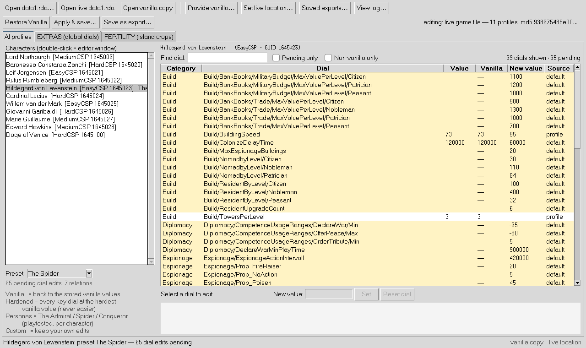

# Anno1404 GameEditor

**Rewrite the minds of your AI rivals in *Anno 1404 History Edition*, and
always be able to change them back.**


Every AI opponent in Anno 1404 (Giovanni, the Baroness, Cardinal Lucius,
Hildegard, Willem and the rest) is driven by roughly a thousand hidden
personality values buried inside the game's `addon/data1.rda`: army size,
fleet aggression, colonization speed, espionage, how readily they declare
war. Anno1404 GameEditor opens that archive, shows every dial next to the
developers' own documentation (translated to English), and lets you turn
any of them. Then it writes the change back with a level of care usually
reserved for databases, not game mods.



<sub>Screenshot taken on the bundled synthetic test archive, so most
"Value" cells are blank. On your real game file every dial shows its live
value.</sub>

## What you can do with it

- **Edit AI personalities.** Every CSP profile in the game, every dial,
  with the vanilla value, the effective value and the schema default side
  by side. Values are type-checked against the game's own schema the moment
  you type them.
- **Apply ready-made personas.** Three personas ship with the tool, each
  extracted one-to-one from a build that was **played in game and
  confirmed working**:

  | Persona | Character | What you get |
  |---|---|---|
  | **The Admiral** | Leif Jorgensen | 20 warships, raids every ~20 s, never flees |
  | **The Spider** | Hildegard von Lewenstein | poisons, revolts, sabotage; nearly impossible to spy on |
  | **The Conqueror** | Willem van der Mark | 80-unit armies, grabs islands, attacks first |

  Or use **Hardened**, which raises any character's key dials to the
  hardest value found anywhere in vanilla and never makes a dial easier.
- **Rewire diplomacy.** Edit each character's War / Ally / Trade / AvoidWar
  lists.
- **Tune the wider game (EXTRAS).** Production times, influence radii,
  housing capacity, norias, warehouse trade, unit and ship speeds, warship
  firepower and maintenance costs: eight dial families (21 dials) across
  hundreds of assets in `assets.xml`.
- **Reshape island fertility.** Let spices grow in the north or hemp in
  the south: per-crop, per-hemisphere generation rates for new islands.
- **Review before you write.** Every save opens a review of each pending
  change (old value -> new value). What you approve is, by construction,
  exactly what gets written.
- **Undo anything.** One click on **Restore Vanilla**, or roll back to any
  pre-save snapshot.

## Quickstart

Requirements: Python 3.10+ and tkinter for the GUI. Nothing else: the
whole tool is Python standard library.

```bash
# unpack the release (annoedit-<version>.zip) and enter the folder
cd annoedit-<version>
python3 -m annoedit.gui.app          # the GUI (Linux: needs python3-tk)
```

On first launch, two banners guide the setup:

1. **Provide vanilla…**: point it at an unmodified `addon/data1.rda`. It is
   stored once as your trusted reference and restore source.
2. **Set live location…**: the `addon/data1.rda` the game actually loads.

Then pick a character, choose a persona or edit dials, press **Apply &
save…**, review, and choose **Save to live** (or **Save as export…** for a
named copy). Start a **new** endless game to meet your new rivals. The full
walkthrough is in [docs/getting-started](docs/getting-started/walkthrough.md).

Everything the GUI does is also scriptable:

```bash
python3 -m annoedit.cli list   data1.rda                        # the roster
python3 -m annoedit.cli dials  data1.rda "Hildegard"            # every dial of one character
python3 -m annoedit.cli flash  data1.rda --persona "The Spider" # apply in place (snapshot first)
python3 -m annoedit.cli relations data1.rda "Leif Jorgensen"    # War/Ally/Trade/AvoidWar
python3 -m annoedit.cli extras data1.rda production             # global dials
python3 -m annoedit.cli fertility data1.rda                     # island crop table
python3 -m annoedit.cli restore data1.rda                       # back to vanilla
python3 -m annoedit.cli --help                                  # all 21 commands
```

`pip install .` additionally gives you `annoedit` and `annoedit-gui`
commands.

## Under the hood

A game editor that writes into a 4,474-file proprietary archive has
exactly one job it must never fail at: **don't break the player's game.**
This project is built around that, layer by layer.

```
 GUI (tkinter)  ·  CLI (argparse)        thin views, no logic of their own
            │
 Session ── ops                          display-free controller; long jobs run as
            │                            pure functions on frozen inputs
 ChangeSet ── plan ── ledger             validated pending edits; the change plan;
            │                            a record of what the tool itself wrote
 model · extras · fertility · spans      byte-exact edit engines over the raw text
            │
 core (ModProject)                       edit -> oracle check -> pack -> verify
            │
 rda                                     RDA V2.0 reader/writer, cipher, zlib
            │
 backup · exports                        write-once vanilla, snapshots, locks
```

### A from-scratch RDA engine

`annoedit/rda.py` is a complete reader and writer for the "Resource File
V2.0" container in pure Python: the 1048-byte header, chained block
records, 540-byte UTF-16 directory entries, zlib, and the game's LCG
stream cipher (applied as a single big-integer XOR against a cached
keystream instead of a per-word loop). Reads are strict and
length-checked: a truncated file, a cyclic block chain, a region past
end-of-file or a duplicate entry name is refused rather than silently
dropped. Writes are atomic: pack to a temp file, fsync, preserve the file
mode, then a single `os.replace`.

### Edits that never re-serialize XML

The edit engine never parses-and-rewrites the game's XML. It splices the
raw text, so every byte outside an edited value stays exactly as the game
shipped it, CRLF line endings included. Locations come from a child-axis
span index that is blind to comments and CDATA, so a commented-out copy of
a character (common in modded files) can never capture an edit, and a
dial path can never be satisfied by a same-named tag at the wrong depth.

Every edit is then checked by an **independent oracle**: a separate
ElementTree parse proves the asset now holds exactly the old values plus
the requested changes, and that not one byte outside the asset moved.
Only then is the change committed to the working copy.

### Saving without trampling other mods

**Save to live** does not overwrite the game file with your copy. It
*replays* your pending edits onto the live file's own contents, locating
every target by identity (character GUID + dial path, asset + tag +
occurrence, tier + crop) rather than by byte offset. Anything you did not
touch survives by construction: other mods, game patches, even other
mods' edits inside the very files this tool edits.

Before that replay, a 3-way drift check compares the archive you opened,
the live file and your pending edits:

- a live value your edit would overwrite is a **conflict** and is shown
  to you before anything is written;
- a live difference you are not editing is **kept**;
- bytes that no modeled surface explains (another mod editing inside the
  same file) are **reported**, never silently reverted.

A **write ledger** records what the tool itself wrote to each target, so
"I cleared an edit I saved earlier" (revert it exactly) is never confused
with "another mod changed this" (keep it).

### The review *is* the build

One pure function, `annoedit/plan.py`, decides which pending rows are real
changes against the file being written. The review window, the pending
counts and the build all consume that same plan, and the build refuses to
run if the plan's hash no longer matches what you approved, or if the
target file changed on disk since you reviewed it.

### A safety net with no holes in it

- Your provided vanilla copy is **write-once** and md5-recorded, is
  verified on every restore, and is checked against a built-in registry of
  known-vanilla hashes when you provide it.
- Every save first snapshots the file it replaces. Snapshots rotate **per
  target**, so exporting a dozen copies can never evict the live game
  file's undo.
- **Restore Vanilla** is surgical by default: it restores only the files
  this tool edits and keeps everything else. A full restore is one flag
  away.
- Protected paths (the stored vanilla copy, the backup and export stores)
  are refused on every write path, not just in the GUI.
- A cross-platform session lock (`flock` / `msvcrt`) means two instances,
  or the GUI and the CLI at once, can never interleave writes.
- Long operations run on a worker thread against frozen snapshots, and only
  the UI thread ever mutates session state. Edits you make while a save is
  running stay pending; they are neither lost nor sneaked into the build.

### Tested like infrastructure

- **540 tests**, standard library only, that run without game data: a
  synthetic RDA archive is generated on the fly, so the whole suite runs on
  any machine.
- **Golden-bytes fixtures** pin the exact bytes six canonical workflows
  emit. A refactor that still "works" but changes a single output byte fails
  loudly.
- **Property tests** throw randomly nested XML at the span engine and check
  its invariants.
- **The GUI is tested too**, headlessly under Xvfb, including end-to-end
  workflows that drive the real App methods (provide vanilla -> open ->
  edit -> review -> save -> reopen).
- **A release gate**: a release can only be cut from a tree whose GUI
  suite passed, bound to that exact tree by a content hash.
- Given a real `data1.rda` (and the reference build), another set of tests
  proves the persona JSONs reproduce the in-game-verified build byte for
  byte.

## Standing on the shoulders of RDAExplorer

[RDAExplorer](https://github.com/lysannschlegel/RDAExplorer) has been
*the* tool for opening Anno's `.rda` archives for more than a decade. Its
authors and contributors (Ruman Gerst, D. Schneider, Lysann Schlegel and
others) did the pioneering work of understanding the container format
across Anno 1404, 2070, 2205 and 1800, and generations of modders have
used it to pull files out of the game and put them back. Its
implementation was an invaluable reference while this project's RDA
engine was cross-checked, and our thanks go to everyone behind it.

The two tools approach the game from different directions:

| | RDAExplorer | Anno1404 GameEditor |
|---|---|---|
| Works at the level of | archive files (browse, extract, replace) | game content (characters, dials, relations, assets, crops) |
| Games / formats | Anno 1404, 2070, 2205, 1800 (RDA V2.0 + V2.2) | Anno 1404 History Edition (RDA V2.0) |
| Editing the XML inside | by hand, outside the tool | built in: typed, validated, verified edits |
| Runs on | Windows (.NET Framework / WPF) | anywhere Python 3.10 runs, Steam Deck included |
| Dependencies | .NET runtime, zlib binaries | none (Python standard library) |
| Safety net | none built in | write-once vanilla, per-target snapshots, surgical restore, locking |
| Other mods in the same archive | whatever you repack | preserved by replay; conflicts shown before writing |
| Automated tests | in its RDA library | 540, including GUI and byte-exact fixtures |
| Scripting | separate FileDB command-line tool | every action available in the CLI |

RDAExplorer remains the broader archive tool today: it covers four games
and both format versions. Anno1404 GameEditor goes deeper instead. It
understands what is *inside* the archive, and its foundations were built
to grow:

- The format layer is self-contained (one module, no dependencies) and
  already handles every block type Anno 1404 ships, with a strict reader
  that refuses anything it does not understand instead of guessing.
- The editing layers are separate modules over a shared span engine, so a
  new surface (quests, buildings, another XML family) is a new module, not
  a rewrite.
- Every behaviour is pinned by tests that run without game data, which is
  what makes contributions from strangers safe to accept.

**Where this is headed.** The natural next steps toward a full successor
are RDA V2.2 (the Anno 2070 / 2205 / 1800 header and 64-bit offsets),
memory-resident blocks, and a generic browse / extract / repack view for
any archive, on top of the safety model that already exists. Contributions
in that direction are very welcome.

## Known limits

- **Only the three personas are verified in game.** EXTRAS, fertility,
  arbitrary relations edits and the Hardened preset are verified by the
  test suite, not yet by long play sessions. Hardened's "which direction is
  harder" table is reasoned per dial, not measured.
- **Old saves keep their AI values.** Changes show up in a **new** endless
  game; fertility applies to newly generated islands only.
- **No delete-leaf operation.** Vanilla mode cannot remove a value that a
  modded archive *added* and vanilla lacks; those are listed when you
  reset. A stored snapshot remains the exact undo.
- **The `.rda` container is repacked on save.** Every member's data is
  identical, but the container bytes are not bit-for-bit those of the
  original (layout and compression are normalized). A restore that ends up
  data-identical to vanilla copies the pristine vanilla bytes instead.
- **A corrupt archive is refused, not repaired.**

More in [Safety and verification](docs/technical/safety-and-verification.md).

## FAQ

**I saved, but nothing changed in game.** Start a **new** endless game:
old saves can carry AI values baked in. This is the most common gotcha.

**How do I get my game back?** GUI: **Restore Vanilla**. CLI:
`python3 -m annoedit.cli restore <data1.rda>`. Any pre-save snapshot can be
restored too: `annoedit snapshots`, then `annoedit restore-snapshot <id>
<target>`.

**Does this affect my own empire?** AI profiles: no. The human player has
no AI profile, so nothing in `config/ai/` can reach you. EXTRAS and
fertility are global and affect everyone equally (there is no owner flag
in `assets.xml`).

**Are schema value ranges enforced?** They produce a warning and a
confirmation, not a block: the in-game-verified personas themselves use
out-of-range values successfully (e.g. `SpyDetectValue` 85). Values are
always hard-limited to what the game can read (32-bit integers, valid
enumerations).

**Where does it keep its data?** `~/.anno1404gameeditor/` (backups,
exports, presets, settings, `annoedit.log`). Set `ANN0140_HOME` to move
all of it.

**Does it ship any game data?** No. Presets are dial values only, and the
dial glossary quotes the schema's descriptions for reference.

## Documentation

- [What is this?](docs/getting-started/what-is-this.md) ·
  [Install](docs/getting-started/install.md) ·
  [5-minute walkthrough](docs/getting-started/walkthrough.md)
- [The RDA V2.0 format](docs/technical/rda-format.md) ·
  [AI profile anatomy](docs/technical/ai-profiles-anatomy.md) ·
  [The edit engine](docs/technical/edit-engine.md) ·
  [Safety and verification](docs/technical/safety-and-verification.md) ·
  [Dial glossary](docs/technical/dial_glossary.md)
- [Changelog](CHANGELOG.md)

## Development

```bash
python3 tests/run_tests.py                         # full suite, no game data needed
xvfb-run -a python3 tests/run_tests.py --require-gui   # also fail if any GUI test skips
ANN0140_TEST_RDA=/path/to/data1.rda python3 tests/run_tests.py   # plus real-archive tests
tools/smoke.sh /path/to/data1.rda                  # CLI flash -> restore round trip on a copy
python3 tools/diagnose.py /path/to/data1.rda       # check engine assumptions on real data
python3 tools/gen_glossary.py data1.rda docs/technical/dial_glossary.md
tools/make_release.sh                              # build the release zip (gated)
```

Byte contract: `tests/golden_bytes.py` drives six canonical workflows
through the real Session stack and pins the four edited members' exact
output bytes in `tests/golden_fixtures.json`. If you change the engine's
output on purpose, re-record with `python3 tests/golden_bytes.py record`
and explain why in `CHANGELOG.md`.

Releasing: `tools/make_release.sh` builds the zip, unpacks it, and runs
the suite from inside the unpacked copy. On a machine without a display,
point `ANN0140_GUI_RESULTS` at a `tests/results.json` from a
`--require-gui` run of the same tree (`ANN0140_PY` picks the interpreter).

Contributions are welcome, especially new personas: a JSON file in
`annoedit/presets/` plus a test is all it takes.

## Credits and license

- MIT licensed, see [LICENSE](LICENSE).
- RDA format knowledge was cross-checked against
  [RDAExplorer](https://github.com/lysannschlegel/RDAExplorer) (BSD
  licensed; © Ruman Gerst, D. Schneider, Lysann Schlegel and
  contributors).
- *Anno 1404 History Edition* is © Ubisoft. This is an unofficial fan
  tool. It contains no game data and is not affiliated with or endorsed
  by Ubisoft.
