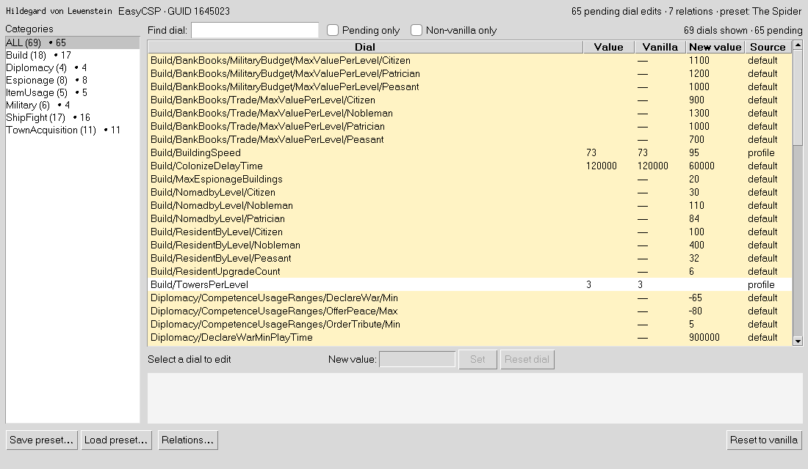
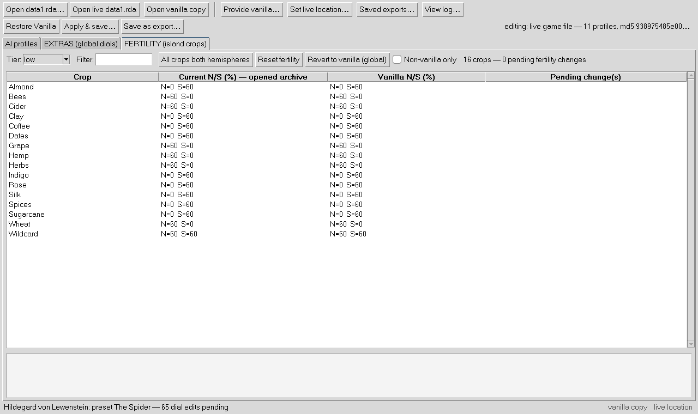

# The 5-minute walkthrough

You've installed the tool and [opened your data1.rda](install.md). Now let's
make Hildegard terrifying.

## 1. Pick a character

In the roster on the left, click **Hildegard von Lewenstein**.

You now see every dial the game gives her — over 500, grouped by category
(Military, ShipFight, Diplomacy, Espionage…). The **Value** column is what's
in effect right now; **Vanilla** is the value in your stored vanilla copy;
**New value** is your pending change (highlighted rows); **Source** tells
you whether the value comes from her profile or from the game's default
table. Type in **Find dial** to narrow the list.

## 2. Apply a persona

Open the **Preset** dropdown under the roster. Besides *Vanilla* and
*Hardened*, you'll see **The Spider** — Hildegard's ready-made persona,
extracted from a mod that was played and verified in game. Pick it.

The **New value** column fills with her pending changes — 65 dials, from
`Prop_Poisen 0 → 45` to `SpyDetectValue 40 → 85` (your spies will almost
never catch hers). Watch what each row means in the doc pane at the bottom:
it shows the developers' description for the selected dial (translated to
English — the game documents them in German).

> Want a different persona for a different character? The dropdown only
> offers personas that fit the selected character (The Admiral belongs to
> Leif, The Conqueror to Willem).

Screenshots use the bundled synthetic test archive; with your real
file the Value column is filled for every dial.

## 3. Fine-tune (optional)

Click any row and type into **New value** under the table — for example,
set `Espionage/Prop_Poisen` to a value of your own — then press **Enter**
(or **Set**). Double-click a row (or press Enter on it) to jump straight
into the box; **Esc** reverts what you typed; **Reset dial** drops just that
change. Hildegard stays selected and the table keeps its place, so you can
work down the list.

For the full editing experience, **double-click Hildegard in the roster** to
open the editor window: categories with pending badges on the left, the
same dial table on the right, and buttons to save your tuned setup as a
named preset you can reload any time. Edits in either window show up in the
other straight away.

## 4. Beyond the AI: EXTRAS and FERTILITY (optional)

The two other tabs edit the wider game, independent of any AI persona:

- **EXTRAS (global dials)** — production speed (`ProductionTime`), building
  influence radii, housing capacity, norias, warehouse trade slots, unit
  and ship speeds, warship firepower, build costs. Edits here are *global*:
  there is no owner flag in the game data, so the AI gets them too.
- **FERTILITY (island crops)** — which crops newly generated islands can
  grow in each hemisphere (e.g. let spices grow in the north).

Both ride along in the same save and are listed in the review window.

## 5. Save it

Press **Apply & save…**.

The review window lists every pending change line by line, and reminds you
of the one thing worth knowing: *old saves can have AI values baked in —
test on a new endless game*. Press **Save to live**, wait ~30–60 seconds
(4,474 files are being repacked and verified), done. It writes to the
**live location** you set — even if you were editing from the vanilla copy
or a saved export — and the file it replaces is snapshotted first. Your
stored vanilla copy (`data1.rda_vanilla`) can never be overwritten.

> Tip: open the **vanilla copy** (toolbar) as your editing baseline. Every
> save is then exactly "vanilla + your changes", and the edits stay pending
> so you can tweak and save again.

Everything you set up — the vanilla copy, the live location and the archive
you last had open — is remembered; next launch, the editor reopens where
you left off.

## 6. Watch it work

Launch the game, start a **NEW endless game**, and look around:

- Hildegard's island empire keeps growing (she builds like Lucius now)
- Your marketplaces get **poisoned**, your cities see **revolts**
- Your spy almost never detects anything of hers
- She declares war early — the Baroness is on her war list

## Changed your mind?

One click: **Restore Vanilla** — the tool copies your stored vanilla archive
back over the live game file. (If that file is the one you have open, its
pending edits are cleared; your saved presets are not.)

## Troubleshooting

| Symptom | Fix |
|---|---|
| Nothing changed in game | You loaded an **old save** — start a new endless game (see the note above) |
| Game runs, characters act vanilla | Check you saved to the file the game loads (the live location); the status line shows the file's md5 |
| Want my old character back but keep others | Select the character, pick **Vanilla** in the dropdown, save again |
| Totally start over | **Restore Vanilla** — full reset |
| Save buttons greyed out | No archive open yet, or a save is still running (watch the status line) |
| "Save to live" greyed out in the review window | Set the live location first (**Set live location…**) |

Back to: [What is this?](what-is-this.md)
